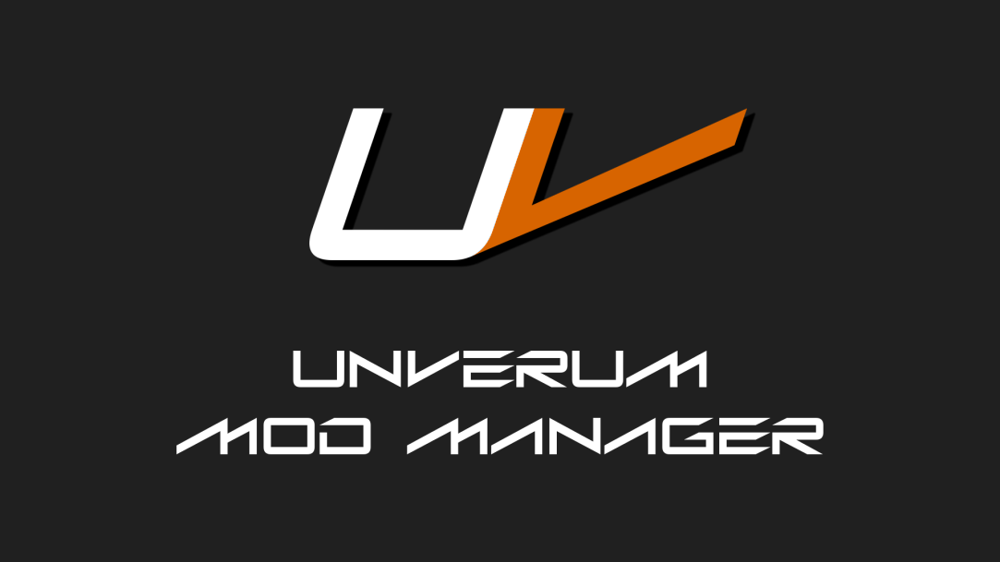

<p align="center"></p>

# Sparking Unverum

Gestor de mods para **DRAGON BALL Sparking! ZERO**, por **Majin**.
*English below.*

Descarga mods de GameBanana sin salir del programa, instálalos con los botones de 1 clic de la web, ordénalos por prioridad, guarda perfiles y mantenlos actualizados.

## Novedades respecto a Unverum

- Solo para Sparking! ZERO: más ligero y sin opciones de otros juegos.
- Tienda conectada a la API v11 de GameBanana, con destacados, novedades, más descargados, categorías, sonidos y búsqueda.
- Botones de 1 clic de GameBanana: si Sparking Unverum ya está abierto, el mod entra en esa ventana.
- Elige qué archivos de un mod descargar. Si el mod ya estaba instalado, puedes reemplazarlo sin perder su posición.
- Detecta el juego automáticamente en cualquier biblioteca de Steam.
- **Nunca borra lo que no es suyo**: lo que hubiera en las carpetas de mods del juego se mueve a `Backups`.
- Avisa cuando dos mods sobrescriben el mismo archivo.
- Instala los plugins `.asi` y ofrece descargar el SparkingZERO Mod Loader si un mod lo necesita.
- Importa tus mods y perfiles de Sparking! ZERO desde el Unverum clásico.
- En español e inglés.
- Se actualiza solo desde las releases de este repositorio. El Unverum clásico ya no puede sobrescribirlo.

## Requisitos

- Windows 10/11 de 64 bits.
- [.NET 10 Desktop Runtime (x64)](https://dotnet.microsoft.com/download/dotnet/10.0). Si no lo tienes, Windows te lo pedirá al abrir el programa.

## Instalación

1. Descarga `SparkingUnverum-vX.Y.Z.zip` de [Releases](https://github.com/MajinSander/Sparking-Unverum/releases).
2. Descomprímelo en una carpeta propia, por ejemplo `C:\SparkingUnverum`. Mejor fuera de `Archivos de programa`.
3. Abre `SparkingUnverum.exe`. Encontrará el juego solo; si no, pulsa **Configurar** y elige `SparkingZERO.exe`.

## Uso rápido

- **Tienda de mods**: busca un mod y pulsa *Descargar*.
- **Mis mods**: marca los mods que quieras y arrástralos para ordenarlos; los de arriba tienen prioridad. Después pulsa **Jugar**.
- **Perfiles**: guarda distintas combinaciones de mods.
- **Ajustes**: idioma, actualizaciones, importar desde el Unverum clásico y quitar todos los mods del juego.

---

## English

Mod manager for **DRAGON BALL Sparking! ZERO**, by **Majin**.

Browse and download GameBanana mods inside the app, install them with the website's 1-click buttons, order them by priority, keep loadouts and get their updates.

- Sparking! ZERO only, GameBanana API v11 store, 1-click installs handed to the open window.
- Pick which files to download and replace installed mods in place.
- Finds the game in every Steam library.
- Never deletes what it didn't install, unknown files in the game mod folders are moved to `Backups`.
- Warns about mods overwriting each other, installs `.asi` plugins and offers to download the SparkingZERO Mod Loader when needed.
- Imports Sparking! ZERO mods and loadouts from the classic Unverum.
- Spanish and English.
- Self-updates from this repository's releases only.

**Requirements:** Windows 10/11 x64 and the [.NET 10 Desktop Runtime (x64)](https://dotnet.microsoft.com/download/dotnet/10.0).

**Install:** download the zip from [Releases](https://github.com/MajinSander/Sparking-Unverum/releases), extract it to its own folder and run `SparkingUnverum.exe`.

## Build

```
dotnet build SparkingUnverum.sln -c Release
```

`build.ps1` creates the release zip.

## License

GPL-3.0, see [LICENSE](LICENSE).
